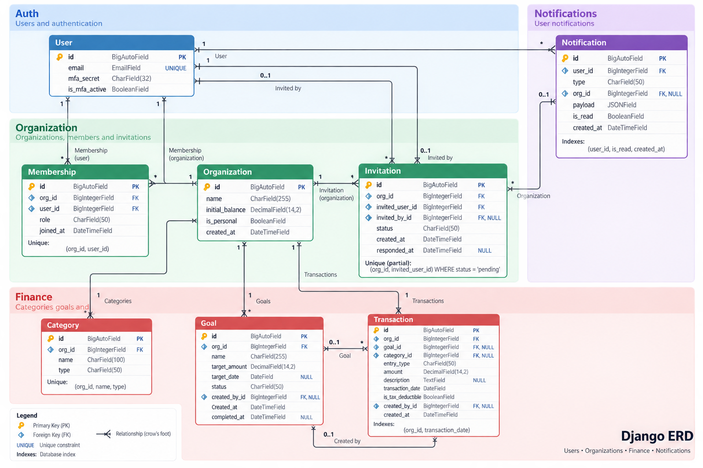

_This project has been created as part of the 42 curriculum by albetanc, cwick, dtimofee, nefimov, tsemenov._

# poolaki

> Multi-user expense tracker web app — 42 `ft_transcendence` team project.

## Description

**poolaki** is a multi-user web application for tracking personal and shared finances.

Each user gets a personal budget on sign-up and can create shared workspaces
(organizations), invite other users, and manage members with `owner` and `member`
roles. All data is scoped to a workspace.

Features:
- **Accounts.** Email/password registration and login, plus 42 OAuth (`intra42`). Sessions are handled by django-allauth; passwords are hashed and salted.
- **Transactions.** Income, expenses, and goal contributions per workspace, with description, amount, date, and category. Filtering by period and category.
- **Categories.** Workspace-scoped labels typed as income, expense, or contribution.
- **Goals.** Savings targets with a target amount and date. Contributions are transactions linked to a goal; progress and status (`active`, `completed`, `archived`) are tracked per goal.
- **Reports.** Yearly report per workspace: income/expense totals, monthly distribution, per-category breakdown, and current balance.
- **Notifications.** In-app inbox for invitations, transactions added in shared workspaces, and goal milestones. The client polls; no websockets.
- **AI assistant.** Natural-language questions about expenses, income, balance, goals, trends, and shared workspaces, answered by a separate FastAPI service that reads data only through the Django API.
- **Concurrency.** Multiple users can work in the same workspace at once; integrity is enforced by PostgreSQL constraints and transactions.

This repository is the team monorepo: `frontend/` (React SPA), `backend/` (Django API,
Caddy, monitoring, backups), `ai-service/` (FastAPI), and `vault/` (secrets) are
deployed together with a single `make` command via Docker Compose.

## Instructions (❗ ADD PROD )

### Prerequisites

- Docker Engine with the Compose plugin (`docker compose`)
- `make`
- `jq` (used by `make readVault`, `make wafLog`, `make auditLog`)
- Optional, for running tests on the host: Node.js 24 and `npm`, Python 3.12+ and `uv`

### Setup

```bash
git clone git@github.com:tim-daria/poolaki.git
cd poolaki
cp .env.example .env
```

Fill in every variable in `.env`. The file is read by Compose and by the Vault
container, which seeds the secrets store from it on first start. Never commit it.

### Run

```bash
make            # dev stack: caddy, backend, frontend, db, vault, vault_agent, ai-service, cloudflared
make prod       # dev stack + prometheus, grafana, postgres_exporter, cadvisor, db_backup
make re         # rebuild images, then start (use after changing a Dockerfile or dependencies)
make down       # stop and remove all containers (both profiles)
make rmVolumes  # same as down, plus delete volumes (database, Vault state, Grafana data)
```

Vault initialises and unseals itself on first start; the backend waits for it.

### URLs

| Service    | URL                                  | Profile |
| ---------- | ------------------------------------ | ------- |
| App        | <http://poolaki.localhost:8080>      | dev     |
| Django admin | <http://poolaki.localhost:8080/admin/> | dev   |
| Vault UI   | <http://localhost:8200/ui>           | dev     |
| Grafana    | <http://grafana.localhost:8080>      | prod    |
| Prometheus | <http://prometheus.localhost:8080>   | prod    |

### Useful targets

```bash
make logs        # compose logs for the dev stack
make status      # running containers
make Tdjango     # shell in the backend container (also: Tnode, Tdb, Tvault, Tai, Tcaddy)
make readVault   # print Vault status and stored credentials (debugging only)
make wafLog      # last Coraza WAF audit entry
```

### Tests

```bash
# backend (clean PostgreSQL container, venv, pytest)
./ci-precheck.sh

# frontend unit tests
cd frontend && npm ci && npm run test

# frontend end-to-end tests (requires the running stack)
cd frontend && npm run test:e2e
```

See [docs/frontend/vitest.md](docs/frontend/vitest.md) and
[docs/frontend/playwright.md](docs/frontend/playwright.md) for details.

## Contributing

See [CONTRIBUTING.md](CONTRIBUTING.md).

## Project Documentation

- Backend API documentation: [Backend Readme](docs/backend/README.md) and [other backend documents](docs/backend)
- AI Service documentation: [AI Readme](docs/ai-service/README.md) and [other AI documents](docs/ai)
- Frontend documentation: [Frontend Readme](docs/frontend/README.md), and other [frontend documents](docs/frontend)
- Input validation, both sides: [docs/validation.md](docs/validation.md)

## Additional Sections [... NEEDS TO BE FILLED ...]

<details>
<summary><strong>❗Team Information</strong></summary>

For each team member mentioned at the top of the README.md, you must provide:
◦ Assigned role(s): PO, PM, Tech Lead, Developers, etc.
◦ Brief description of their responsibilities.

</details>

<details>
<summary><strong>❗Project Management</strong></summary>

- **Organisation.** The team met once a week to review progress, decide what to build next and split the work. Tasks were assigned at these meetings and tracked until done.

- **Tools.** Work items were tracked as GitHub Issues, one issue per task or bug, closed by the pull request that resolved it. A GitHub Projects board gave an overview of the issues by status (to do, in progress, done) and by assignee, and was reviewed at each weekly meeting. Miro boards were used for planning: sketching screens, mapping data flows and laying out the module roadmap before anything was coded.

- **Communication.** Day-to-day communication happened in a shared Slack workspace. Slack carried quick questions, pull request links and decisions made between meetings, so that nothing depended on everyone being in the same room.

</details>

<details>
<summary><strong>❗Technical Stack</strong></summary>

**Frontend**

| Technology | Role |
| --- | --- |
| React 19 + TypeScript 6 | UI, compiled with the React Compiler (Babel plugin) |
| Vite 8 | Dev server and production bundler |
| React Router 7 | Client-side routing, lazy route chunks |
| MUI 9 (Material, X Charts, X Date Pickers) + Emotion | Component library; all styling flows from one `createTheme` in `src/theme.ts` |
| dayjs | Date handling |
| react-markdown + remark-gfm | Rendering AI chat replies |
| Vitest, Playwright, ESLint, Prettier | Unit tests, end-to-end tests, lint, format |

**Backend**

| Technology | Role |
| --- | --- |
| Django 6 + Django REST Framework | Business logic, users, organizations, transactions, goals, reports; versioned JSON API under `/api/v1/` |
| django-allauth (headless) | Email/password sessions and 42 OAuth (`intra42`) through the `/_allauth/` API |
| psycopg 3 | PostgreSQL driver |
| django-prometheus | Request and DB metrics for Prometheus |
| pytest, pytest-django, ruff, mypy (strict), uv | Tests, lint, typing, dependency management |

**AI service**

| Technology | Role |
| --- | --- |
| FastAPI + Uvicorn | Separate microservice for conversations over financial data |
| httpx | Calls to an OpenAI-compatible `/chat/completions` endpoint and to the Django API |
| asyncpg + pgvector | Stores document chunks and embeddings for retrieval (RAG) |
| pydantic-settings | Configuration |

**Database**

PostgreSQL 18 (`pgvector/pgvector:pg18` image). Chosen because:
- Relational, transactional storage fits money: foreign keys, constraints, and ACID writes prevent inconsistent balances under concurrent users.
- First-class Django ORM support, including migrations.
- The `vector` extension lets the AI service store and search embeddings in the same database instead of adding a separate vector store.
- Dynamic, short-lived credentials are issued per service by Vault's database secrets engine.

**Infrastructure**

| Technology | Role |
| --- | --- |
| Docker Compose | Single-command deployment of all services; `prod` profile adds monitoring and backups |
| Caddy + Coraza WAF (OWASP Core Rule Set) | Reverse proxy on port 8080, routes `/api`, `/_allauth`, `/admin` to Django and everything else to the frontend |
| HashiCorp Vault + Vault Agent | Secrets storage; AppRole-scoped read access; dynamic PostgreSQL credentials with TTL |
| Cloudflare Tunnel (`cloudflared`) | Publishes the app at `poolaki.de` without opening inbound ports |
| Prometheus, Grafana, postgres_exporter, cAdvisor | Metrics, dashboards, email alerts |
| `db_backup` container | Daily `pg_dump` to `backend/backups` |
| GitHub Actions | CI per changed area: backend ruff/mypy/pytest, frontend format/lint/vitest/build, Playwright e2e against the compose stack |

**Justification of major choices**

- **Django for the core.** Mature auth, ORM, migrations, and admin reduce the amount of security-sensitive code written by hand. Django is the single owner of users and financial data.
- **Separate FastAPI service for AI.** AI workloads scale and change independently of business rules; the LLM provider can be swapped without touching the backend. The service never reads user data from the database directly, only through the Django API, so tenant isolation is enforced in one place (see [docs/ai/decisions.md](docs/ai/decisions.md)).
- **React + MUI.** Typed components and a central theme keep the UI consistent; no hardcoded colours or spacing outside the theme (see [docs/frontend/mui-and-styles.md](docs/frontend/mui-and-styles.md)).
- **Vite over a heavier framework.** The app is a client-side SPA behind an API; it needs a fast dev server and route-level code splitting, not SSR.
- **Vault instead of plain `.env`.** Secrets are encrypted at rest, each service reads only its own paths, and leaked database credentials expire on their own (see [docs/backend/vault.md](docs/backend/vault.md)).
- **Caddy with Coraza.** One container gives routing, per-host logging, and a WAF in front of both the API and the SPA.
- **Cloudflare Tunnel.** TLS and public exposure handled by Cloudflare; the host needs no open inbound ports.

</details>

<details>
<summary><strong>❗Database Schema</strong></summary>



The schema is relational PostgreSQL, managed by Django migrations. Every model
uses a `BigAutoField` primary key (`id`). `ForeignKey` columns are stored as
`BIGINT` values referencing the related `id`.

### Tables and relationships

- **`core_user`** — application users. Django's `AbstractUser` fields include
  username, password, name, email, staff/active flags, and timestamps; the
  project adds MFA fields. A user can belong to many organizations through
  memberships, create goals and transactions, receive invitations and
  notifications, and invite other users.
- **`core_organization`** — personal or shared workspaces. Organizations have
  many memberships, invitations, categories, goals, transactions, and
  notifications.
- **`core_membership`** — the many-to-many join table between users and
  organizations, with a `role` (`owner` or `member`). An `(org, user)` pair is
  unique.
- **`core_invitation`** — an invitation to join an organization. It references
  the organization, the invited user, and optionally the inviting user. At
  most one pending invitation exists for a given `(org, invited_user)` pair.
- **`core_category`** — organization-scoped transaction categories. A category
  is typed as `income`, `expense`, or `contribution`; `(org, name, type)` is
  unique.
- **`core_goal`** — organization-scoped savings goals, optionally created by a
  user. Transactions may reference a goal to record contributions or
  withdrawals.
- **`core_transaction`** — organization-scoped financial entries. Each entry
  may reference a goal and category and optionally the creating user. The
  organization, goal, category, and user relationships are independent, so
  deleting an organization cascades while deleting a goal, category, or user
  preserves the transaction by setting that reference to `NULL`.
- **`core_notification`** — user inbox entries, optionally associated with an
  organization. Notifications contain a typed event and JSON payload; deleting
  the user cascades, while deleting the organization sets its reference to
  `NULL`.

### Key fields and data types

| Table | Key fields |
| --- | --- |
| `core_user` | `id BIGINT`; `email VARCHAR(254) UNIQUE NOT NULL`; `mfa_secret VARCHAR(32) NOT NULL DEFAULT ''`; `is_mfa_active BOOLEAN NOT NULL DEFAULT FALSE`; inherited Django authentication fields |
| `core_organization` | `id BIGINT`; `name VARCHAR(100) NOT NULL`; `initial_balance NUMERIC(14,2) NOT NULL DEFAULT 0`; `is_personal BOOLEAN NOT NULL DEFAULT FALSE`; `created_at TIMESTAMPTZ NOT NULL` |
| `core_membership` | `id BIGINT`; `org_id BIGINT NOT NULL`; `user_id BIGINT NOT NULL`; `role VARCHAR(20) NOT NULL DEFAULT 'member'`; `joined_at TIMESTAMPTZ NOT NULL`; unique `(org_id, user_id)` |
| `core_invitation` | `id BIGINT`; `org_id BIGINT NOT NULL`; `invited_user_id BIGINT NOT NULL`; `invited_by_id BIGINT NULL`; `status VARCHAR(20) NOT NULL DEFAULT 'pending'`; `created_at TIMESTAMPTZ NOT NULL`; `responded_at TIMESTAMPTZ NULL`; unique pending `(org_id, invited_user_id)` |
| `core_category` | `id BIGINT`; `org_id BIGINT NOT NULL`; `name VARCHAR(50) NOT NULL`; `type VARCHAR(20) NOT NULL`; unique `(org_id, name, type)` |
| `core_goal` | `id BIGINT`; `org_id BIGINT NOT NULL`; `name VARCHAR(100) NOT NULL`; `target_amount NUMERIC(14,2) NOT NULL`; `target_date DATE NULL`; `status VARCHAR(20) NOT NULL DEFAULT 'active'`; `created_by_id BIGINT NULL`; `created_at TIMESTAMPTZ NOT NULL`; `completed_at DATE NULL` |
| `core_transaction` | `id BIGINT`; `org_id BIGINT NOT NULL`; `goal_id BIGINT NULL`; `category_id BIGINT NULL`; `entry_type VARCHAR(20) NOT NULL`; `amount NUMERIC(14,2) NOT NULL`; `description VARCHAR(1024) NULL`; `transaction_date DATE NOT NULL`; `is_tax_deductible BOOLEAN NOT NULL DEFAULT FALSE`; `created_by_id BIGINT NULL`; `created_at TIMESTAMPTZ NOT NULL` |
| `core_notification` | `id BIGINT`; `user_id BIGINT NOT NULL`; `type VARCHAR(30) NOT NULL`; `org_id BIGINT NULL`; `payload JSONB NOT NULL DEFAULT '{}'`; `is_read BOOLEAN NOT NULL DEFAULT FALSE`; `created_at TIMESTAMPTZ NOT NULL` |

Status/type choices are stored as strings: invitation status is `pending`,
`accepted`, `declined`, or `cancelled`; goal status is `active`, `completed`,
or `archived`; and transaction entry type is `income`, `expense`,
`contribution`, or `withdraw`. The schema indexes transactions by
`(org_id, transaction_date)` and notifications by
`(user_id, is_read, created_at)`.

</details>

<details>
<summary><strong>Features List</strong></summary>

The following table lists the implemented product features, the team members
who contributed to them, and a brief description of their functionality.
Contributors are identified by the usernames listed at the top of this
README.

| Feature | Team member(s) | Description |
| --- | --- | --- |
| User accounts and authentication | `dtimofee`, `tsemenov` | Email/password registration and login, session management, logout, CSRF protection, protected routes, password changes, and 42 (Intra) OAuth sign-in. |
| Personal budgets and balances | `nefimov`, `tsemenov` | Creates a personal workspace for each user, supports an initial balance, and calculates the current balance from income, expenses, and goal transfers. |
| Shared workspaces | `dtimofee`, `tsemenov`, `mainibet` | Users can create workspaces, switch between them, view members, leave a workspace, and manage workspace membership with owner and member roles. |
| Workspace invitations | `dtimofee`, `tsemenov`, `mainibet` | Workspace owners can invite users and cancel invitations; invited users can review, accept, or decline invitations. |
| Transactions | `nefimov`, `dtimofee`, `tsemenov` | Tracks income, expenses, contributions, and withdrawals with amounts, descriptions, dates, categories, goals, and tax-deductible status. Transactions can be listed, filtered, edited, and deleted. |
| Transaction categories | `nefimov`, `dtimofee`, `tsemenov` | Provides workspace-scoped income, expense, and contribution categories, with filtering and duplicate-prevention rules. |
| Savings goals | `nefimov`, `tsemenov`, `dtimofee` | Creates savings targets with optional target dates, tracks contributions and withdrawals, calculates progress and balances, and supports active, completed, and archived statuses. |
| Financial reports | `dtimofee`, `nefimov`, `tsemenov` | Provides yearly workspace reports with income and expense totals, monthly distributions, category breakdowns, savings information, current balance, charts, year selection, and print-friendly output. |
| Home dashboard | `tsemenov`, `nefimov`, `dtimofee` | Summarizes the selected workspace with balance, monthly activity, recent transactions, top spending, savings goals, and setup guidance. |
| Notifications | `dtimofee`, `mainibet`, `tsemenov` | Provides an in-app inbox for invitations, transaction activity, goal milestones, and workspace membership events. The frontend polls for updates and shows unread counts. |
| AI financial assistant | `mainibet`, `dtimofee`, `tsemenov` | Answers supported natural-language questions about workspace finances through a separate FastAPI service using intent classification, Django API retrieval, vector retrieval, prompt construction, and an external LLM. |
| Responsive web interface | `tsemenov`, `mainibet` | React single-page application with lazy routes, responsive desktop and mobile layouts, workspace navigation, drawers, bottom sheets, charts, date controls, money formatting, toast feedback, and Markdown-rendered AI responses. |
| Workspace authorization | `nefimov`, `dtimofee`, `tsemenov` | Restricts workspace-scoped API operations to members and limits sensitive actions, such as invitations, member removal, and workspace administration, to owners. |
| Input validation and API protection | `dtimofee`, `nefimov`, `tsemenov` | Validates request payloads, query parameters, identifiers, monetary values, dates, categories, goals, and AI questions before processing them. |
| Session and CSRF security | `dtimofee`, `tsemenov` | Uses django-allauth sessions, protected routes, CSRF tokens, secure logout, and authenticated API requests for browser access. |
| Database integrity and concurrency control | `nefimov`, `dtimofee`, `cwick` | Uses PostgreSQL foreign keys, unique constraints, indexes, decimal fields, atomic transactions, and workspace scoping to keep financial data consistent when multiple users work concurrently. |
| Secrets management | `cwick` | Stores service secrets in HashiCorp Vault, uses AppRole-scoped access, initializes and unseals Vault automatically, and issues short-lived database credentials through Vault’s database secrets engine. |
| Web application firewall | `cwick` | Places Coraza WAF with the OWASP Core Rule Set in front of the frontend and API, records audit information, and blocks malicious HTTP requests before they reach application services. |
| Containerized deployment | `cwick` | Runs the frontend, Django backend, PostgreSQL, AI service, Vault, Vault Agent, Caddy, and Cloudflare Tunnel through Docker Compose with development and production profiles. |
| Reverse proxy and service routing | `cwick` | Uses Caddy as the single application entry point, routing API, authentication, administration, and frontend requests to the appropriate internal service. |
| Public access through Cloudflare Tunnel | `cwick` | Publishes the application through Cloudflare Tunnel without requiring open inbound ports on the host. |
| Service health checks | `nefimov`, `cwick`, `dtimofee` | Exposes health endpoints and Docker health checks so dependent services and CI can wait for the database, backend, Vault, AI service, and tunnel to become ready. |
| Metrics and observability | `cwick` | Collects application and database metrics with Prometheus, PostgreSQL exporter, and cAdvisor; provides Grafana dashboards, traffic visibility, and alerting. |
| Database backup and recovery | `cwick` | Runs scheduled PostgreSQL dumps in a dedicated backup container and keeps backup-related storage separate from the application services. |
| Testing and CI | `tsemenov`, `dtimofee`, `mainibet` | Backend pytest, Ruff, and mypy checks; frontend Vitest, Playwright, ESLint, Prettier, and build checks; plus CI workflows for the relevant project areas. |

</details>

<details>
<summary><strong>❗Modules</strong></summary>

◦ List of all chosen modules (Major and Minor).
◦ Point calculation (Major = 2pts, Minor = 1pt).
◦ Justification for each module choice, especially for custom "Modules of
choice".
◦ How each module was implemented.
◦ Which team member(s) worked on each module.

## Modules of Choice

| Points | Module | Author | Description | Docs |
| --- | --- | --- | --- | --- |
| 2p | **Major: Web.** Use a framework for both the frontend and backend. | dtimofee, tsemenov | Django + React Router | [docs/modules/backend-integration.md](docs/modules/backend-integration.md), [docs/modules/input-validation.md](docs/modules/input-validation.md), [docs/frontend/routing.md](docs/frontend/routing.md), [docs/frontend/password-change.md](docs/frontend/password-change.md) |
| 1p | **Minor: Web.** Use an ORM for the database | ❗ | ❗ | ❗ |
| 1p | **Minor: Web.** A complete notification system for all creation, update, and deletion actions | ❗ | ❗ | ❗ |
| 1p | **Minor: Web.** Custom-made design system with reusable components, including a proper color palette, typography, and icons (minimum: 10 reusable components). | tsemenov | Custom design system based on MUI | [docs/modules/design-system.md](docs/modules/design-system.md), [docs/frontend/mui-and.styles.md](docs/frontend/mui-and.styles.md]), [docs/frontend/money.md](docs/frontend/money.md), [docs/frontend/drawers.md](docs/frontend/drawers.md) |
| 1p | **Minor: Web.** Implement advanced search functionality with filters, sorting, and pagination. | dtimofee, tsemenov | Transactions page | ❗ |
| 1p | **Minor: Accessibility.** Support for additional browsers. | tsemenov | Cromium, firefox, Webkit | [docs/frontend/browser-support.md](docs/frontend/browser-support.md) |
| 1p | **Minor: User Management.** Implement remote authentication with OAuth 2.0 (Google, GitHub, 42, etc.). | dtimofee | ❗ | ❗ |
| 2p | **Minor: User Management.** Advanced permissions system. | ❗ | ❗ | ❗ |
| 2p | **Major: User Management.** An organization system. | ❗ | ❗ | ❗ |
| 1p | **Minor: User Management.** User activity analytics and insights dashboard. | ❗ | ❗ | ❗ |
| 2p | **Major: Artificial Intelligence.** Implement a complete RAG (Retrieval-Augmented Generation) system. | ❗ | ❗ | ❗ |
| 2p | **Major: Artificial Intelligence.** Implement a complete LLM system interface. | ❗ | ❗ | ❗ |
| 2p | **Major: Cybersecurity.** Implement WAF/ModSecurity (hardened) + HashiCorp Vault for secrets. | ❗ | ❗ | ❗ |
| 2p | **Major: DevOps.** Monitoring system with Prometheus and Grafana. | ❗ | ❗ | ❗ |
| 2p | **Major: DevOps.** Health check and status page system with automated backups and disaster recovery procedures. | ❗ | ❗ | ❗ |
| 1p | **Minor: Data & Analytics.** Advanced analytics dashboard with data visualization | dtimofee | A yearly report over income, expenses and savings: one aggregation endpoint, custom charts and a print-ready layout. | [docs/modules/reports-and-analytics.md](docs/modules/reports-and-analytics.md), [docs/backend/reports.md](docs/backend/reports.md) |

</details>

<details>
<summary><strong>❗Individual Contributions</strong></summary>

◦ Detailed breakdown of what each team member contributed.
◦ Specific features, modules, or components implemented by each person.
◦ Any challenges faced and how they were overcome.

<details>
<summary><strong>Tanya (🎀 tsemenov) — Frontend</strong></summary>

**Scope.** Owner of `frontend/`: product design, UX/UI, architecture, tests, CI job, and `docs/frontend/`.

**Design and user flow**
- Designed the app structure and user flow: sign-up or 42 login, personal budget with an initial balance, workspace switcher, then Home, Transactions, Goals, Reports and Settings. Shared workspaces follow the same flow after an invitation.
- Made mockups for every page and modal before implementation, and iterated on them with the team.
- Built a design system in the MUI theme: colour tokens, two type stacks, spacing, card variants ([docs/frontend/design-system.md](docs/frontend/design-system.md)).
- Made every page responsive: top navigation on desktop, bottom navigation and bottom sheets on phones, print layout for reports.

**Implementation**
- Built the auth flow, routing, app shell, workspaces and invitations, Transactions and Home. Helped with Goals, Reports and the AI chat UI.
- Shared pieces: theme, `Money` formatting, toasts, segmented controls, card header.

**Tooling and quality**
- React Compiler and Vite setup, Vitest unit tests, Playwright e2e suite, frontend CI job, `AGENTS.md` guidelines and frontend docs.

**Challenges**
- **Making the app intuitive.** Goals, shared workspaces and overdrafts are not simple concepts, so the interface had to explain them in plain language. Our rule was to hide or disable actions that aren't allowed, rather than let them fail.
- **Composition and user flow.** Deciding what each page shows first, what stays one tap away, and where the single main action goes.
- **Desktop and mobile.** One design had to work on both screens. Cards, modals, tables and charts were reworked for phones, not just shrunk.
- **Consistency.** Keeping the look uniform across many pages, which is why every style decision lives in the theme.
</details>
</details>

## Resources

- Project subject: 42 `ft_transcendence`
  
- [django-allauth: Headless API ](https://docs.allauth.org/en/latest/headless/index.html)
- [The TypeScript Handbook](https://www.typescriptlang.org/docs/handbook/intro.html)
- [Mozilla Web Docs](https://developer.mozilla.org/en-US/)
- [React Official Documentation](https://react.dev/)
- [React Router Official Documentation](https://reactrouter.com/)
- [Vite Official Documentation](https://vite.dev/guide/)
- [GitHub Secrets How-To](https://docs.github.com/en/actions/concepts/security/secrets)
- [Playwright Documentation](https://playwright.dev/)
- [Vitest Documentation](https://vitest.dev/)
- [Laws of UX](https://lawsofux.com/)

[ ❗... ADD MORE... ]

## AI Usage

AI tools were used in this project for the following purposes:

- **Planning:** structuring and prioritising the work.
- **Learning:** finding resources and understanding new concepts.
- **Design:** generating mockups.
- **Code review:** reviewing changes and spotting issues.
- **Code optimisation:** refactoring and simplifying existing code.
- **Migration:** moving pages to MUI correctly and consistently.
- **Testing:** drafting and extending unit and end-to-end tests.
- **Documentation:** drafting and editing project documentation.
- **Commits and pull requests:** writing and polishing commit messages and PR descriptions.

[ ❗... ADD MORE... ]

Security practices for writing workflows and using GitHub Actions features
Using secrets in GitHub Actions

Software Testing Course
