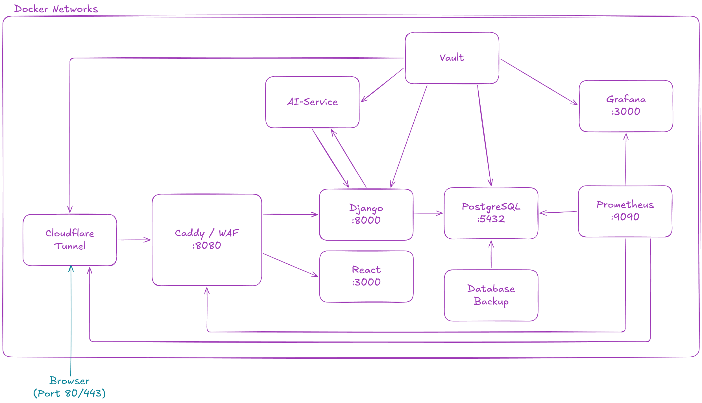
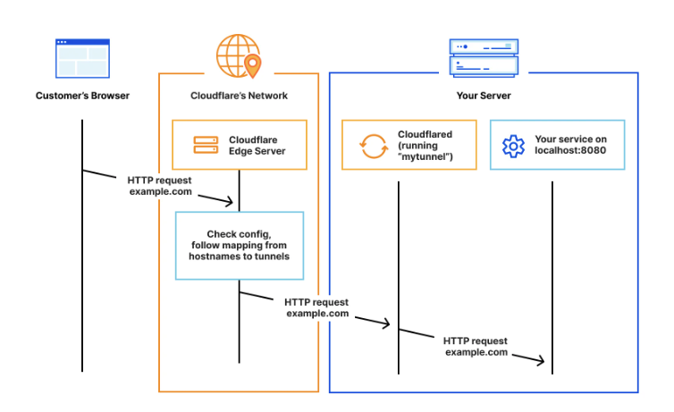

# Docker Infrastructure



# Cloudflare Tunnel

## How it works

`cloudflared` establishes **outbound connections** (tunnels) between your resources and Cloudflare's global network. A tunnel is a persistent object identified by a UUID — it serves as the logical link between your origin and Cloudflare. Within the same tunnel, you can run as many `cloudflared` processes (**connectors**) as needed. Each connector sends traffic to the nearest Cloudflare data center.



In this project the tunnel is the only way the app reaches the internet. The host opens no inbound ports: the `cloudflared` container dials out to Cloudflare, Cloudflare terminates TLS for `poolaki.de`, and requests are forwarded over the tunnel to Caddy on the internal Docker network.

```
Browser ──https──▶ Cloudflare edge ──tunnel──▶ cloudflared ──http──▶ caddy:80 ──▶ frontend / backend
```

## Prerequisites

- A **Cloudflare account**
- A domain managed by Cloudflare DNS (`poolaki.de`)
- A host with outbound internet access running the Docker stack

## Pieces in the repository

| Piece | Where | What it does |
|---|---|---|
| Image | [`backend/cloudflare/Dockerfile`](../../backend/cloudflare/Dockerfile) | Copies the pinned `cloudflared` binary into an Alpine image with CA certificates and runs as the unprivileged user `65532`. Bump the version by changing the `cloudflare/cloudflared:<version>` tag in the first `FROM` line. |
| Entrypoint | [`backend/cloudflare/entrypoint.sh`](../../backend/cloudflare/entrypoint.sh) | Waits for the Vault Agent to render the token file, sources it, then `exec`s `cloudflared tunnel run`. |
| Service | `cloudflared` in [`docker-compose.yml`](../../docker-compose.yml) | Mounts the `cloudflare` subpath of the `vault_agent` volume read-only, joins `tunnel_net`, depends on a healthy `vault`. |
| Secret | `secret/cloudflare` in Vault | Holds `tunnel_token`. Seeded from `TUNNEL_TOKEN` in `.env` by [`vault/entrypoint.sh`](../../vault/entrypoint.sh) on first init. |
| Template | [`vault/agent/templates/cloudflare-creds.tpl`](../../vault/agent/templates/cloudflare-creds.tpl) | Vault Agent renders it to `/vault/agent/secrets/cloudflare/cloudflare-creds.env` (see [`agent.hcl`](../../vault/config/hcl/agent.hcl)). The agent policy grants read on `secret/data/cloudflare` only. |
| Origin | `poolaki.de:80` site block in [`backend/caddy/Caddyfile`](../../backend/caddy/Caddyfile) | Caddy serves the public hostname on plain HTTP (`auto_https off`) because Cloudflare already terminated TLS. The block applies the WAF and proxies `/api/v1`, `/admin`, `/_allauth`, `/accounts`, `/static` to `backend:8000` and everything else to `frontend:5173`. |

## Secrets flow

The tunnel token never reaches the `cloudflared` container through the environment. The flow is:

1. `TUNNEL_TOKEN` in `.env` is read by the Vault container on its **first** initialisation and written to `secret/cloudflare`. Changing `.env` afterwards does nothing until Vault is re-initialised (`make fclean` wipes the volume) or the secret is updated in Vault directly.
2. The Vault Agent authenticates with AppRole, renders `cloudflare-creds.tpl` and writes `TUNNEL_TOKEN=…` to the shared `vault_agent` volume.
3. The `cloudflared` entrypoint polls for that file for up to **60 seconds** and exits with `Timed out waiting for Vault secrets` if it never appears. With `restart: unless-stopped` Docker then retries, so a slow Vault start shows up as a few restarts rather than a permanent failure.

Read the stored token with `vault/read_vault.sh` (section `cloudflare`), or rotate it with:

```
docker compose exec vault vault kv put secret/cloudflare tunnel_token="<new token>"
docker compose restart cloudflared
```

See [vault.md](vault.md) for how the agent and AppRole are configured.

## Cloudflare dashboard side

The tunnel is **remotely managed**: the repository contains no `config.yml` for `cloudflared`. Ingress rules live in the Cloudflare Zero Trust dashboard under *Networks → Tunnels*:

- The tunnel's **public hostname** `poolaki.de` must point at the service `http://caddy:80`. `caddy` resolves on `tunnel_net` because both containers are on that network.
- The **tunnel token** shown on the tunnel's *Install connector* page is the value for `TUNNEL_TOKEN`.
- Creating a new tunnel means: create it in the dashboard, add the public hostname → `http://caddy:80`, copy the token into `.env` (or straight into Vault as above), and restart `cloudflared`.

Grafana and Prometheus are intentionally **not** published through the tunnel. They stay on the local Caddy hostnames `http://grafana.localhost:8080` and `http://prometheus.localhost:8080`.

## Networking

`tunnel_net` is shared by `cloudflared`, `caddy`, `prometheus` and `grafana`. `cloudflared` is on no other network, so it can only reach Caddy, never the backend, database or Vault directly. Caddy fans out to `frontend_net` and `backend_net`.

The local hostnames (`poolaki.localhost`, `grafana.localhost`, `prometheus.localhost`) are served on `localhost:8080` over plain HTTP. If a browser insists on redirecting to `https`, it has cached an HSTS entry from an earlier setup: clear the site data for that host and try again.

## Health and monitoring

- The compose **healthcheck** runs `cloudflared tunnel ready`, which succeeds only once at least one connection to the Cloudflare edge is established.
- `cloudflared` exposes **Prometheus metrics** on `0.0.0.0:60123` (set in the entrypoint). Prometheus scrapes `cloudflared:60123` every 5 s ([`prometheus.yml`](../../backend/monitoring/prometheus.yml)).
- The Grafana *Caddy* dashboard has panels for Cloudflare response codes, request errors and total requests, built on `cloudflared_tunnel_response_by_code`, `cloudflared_tunnel_request_errors` and `cloudflared_tunnel_total_requests`.

## CI and tests

[`docker-compose.ci.yml`](../../docker-compose.ci.yml) puts `cloudflared` (and the monitoring services) in the `donotstart` profile, so CI and the Playwright suite run against `http://poolaki.localhost:8080` without a tunnel. Anything that needs the real TLS origin, such as the WebKit checks in [browser-support.md](../frontend/browser-support.md), must be tested against `https://poolaki.de`.

## Troubleshooting

| Symptom | Likely cause | Check |
|---|---|---|
| `Waiting for initial Vault secrets…` then exit | Vault not initialised or agent not running | `docker compose logs vault vault_agent` |
| Container healthy but `poolaki.de` returns 502 / 530 | Public hostname does not point at `http://caddy:80`, or Caddy is down | Zero Trust dashboard → tunnel → Public Hostname; `docker compose logs caddy` |
| `Unauthorized: Failed to get tunnel` | Token revoked or belongs to a deleted tunnel | Regenerate the token, update `secret/cloudflare`, restart |
| Healthcheck never passes | No outbound connectivity to Cloudflare (port 7844 UDP/TCP) | `docker compose exec cloudflared cloudflared tunnel ready` |

```
docker compose logs -f cloudflared
```

---
# Web application firewall

Coraza is an open source, enterprise-grade, high performance Web Application Firewall (WAF).
It written in Go, supports ModSecurity SecLang rulesets and is 100% compatible with the OWASP Core Rule Set.

For more information visit: https://www.coraza.io/docs/tutorials/introduction/

## Testcommands

**== SQL Injection attempt ==**

**in terminal**
```
curl -G "https://poolaki.de/api/" --data-urlencode "id=1' OR '1'='1"
```
```
curl -G "http://poolaki.localhost:8080/api/" --data-urlencode "id=1' OR '1'='1"
```

**in Browser**
```
https://poolaki.de/api/?id=1' OR '1'='1
```
```
http://poolaki.localhost:8080/api/?id=1' OR '1'='1
```
---

**== XSS attempt ==**

in terminal
```
curl "https://poolaki.de/api/?q=<script>alert(1)</script>"
```
```
curl "http://poolaki.localhost:8080/api/?q=<script>alert(1)</script>"
```
in Browser
```
https://poolaki.de/api/?q=<script>alert(1)</script>
```
```
http://poolaki.localhost:8080/api/?q=<script>alert(1)</script>
```

---

**== Path traversal ==**

*Percent encoding (aka URL encoding)*

`%2e%2e%2f` represents `../`

The decoded path looks like:
`https://poolaki.de/api/../../etc/passwd`

in terminal
```
curl "https://poolaki.de/api/%2e%2e%2f%2e%2e%2fetc%2fpasswd"
```
```
curl "http://poolaki.localhost:8080/api/%2e%2e%2f%2e%2e%2fetc%2fpasswd"
```

in browser
```
https://poolaki.de/api/%2e%2e%2f%2e%2e%2fetc%2fpasswd
```
```
http://poolaki.localhost:8080/api/%2e%2e%2f%2e%2e%2fetc%2fpasswd
```

---

**== Bad User-Agent (scanner detection) ==**

in terminal
```
curl -A "sqlmap/1.0" "http://poolaki.localhost:8080/api/"
```
```
curl -A "sqlmap/1.0" "https://poolaki.de/api/"
```

---

**== Command injection ==**

in terminal
```
curl "http://poolaki.localhost:8080/api/?cmd=;cat%20/etc/passwd"
```
```
curl "https://poolaki.de/api/?cmd=;cat%20/etc/passwd"
```
in browser
```
http://poolaki.localhost:8080/api/?cmd=;cat%20/etc/passwd
```
```
https://poolaki.de/api/?cmd=;cat%20/etc/passwd
```

---

After each command you can run the following command.
It creates a file named `auditlog` with all details for the last log from coraza.

```
docker compose exec caddy tail -1 /coraza/logs/audit.log | jq > auditlog_lastLine
```

You can see a lot of informations like the attacked server, the attack type and if it was blocked by the firewall.

``` title:audit.log
"server_id": "poolaki.localhost",
...
"error_message": "[client \"172.21.0.1\"] Coraza: Warning. SQL Injection Attack Detected...
...
```
